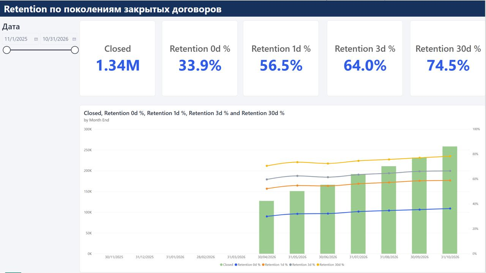
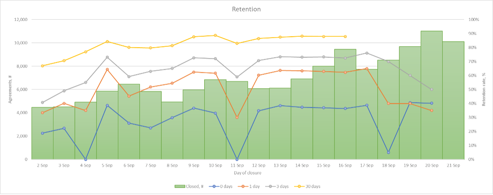

# Retention Analysis

**Тестовое задание: SQL, анализ Retention и дашборд в Power BI**

[**Открыть сайт с решением →**](https://heissasss.github.io/retention-analysis/)

 

---

## Задачи

| № | Тема | Что сделано |
|---|------|-------------|
| 1 | Сотрудники | SQL-запрос: сотрудники, у которых в работе менее трёх задач |
| 2 | Кредиты | SQL-запрос: суммы платежей по основному долгу и процентам по договорам, где платили и то и другое |
| 3 | График Retention | Анализ графика, выводы и рекомендации |
| 4 | Power BI | Интерактивный дашборд с динамикой Retention |

## Результаты анализа Retention

- Количество закрытий растёт: с 4,5 до 11 тысяч в день, почти в 2,4 раза.
- Retention за 30 дней достигает примерно 88%.
- Основная часть возвратов приходится на первые 1–3 дня после закрытия договора.

## Файлы

| Файл | Описание |
|------|----------|
| [`Marfin_Denis.ipynb`](Marfin_Denis.ipynb) | Ноутбук с SQL-кодом, наполнением таблиц и результатами выполнения |
| [`Marfin_Denis.pbix`](Marfin_Denis.pbix) | Дашборд Power BI и модель данных |
| [`index.html`](index.html) | Страница сайта с решением |
| `retention.png`, `powerbi_dashboard.jpg` | Изображения для сайта и README |

## Автор

Марфин Денис Дмитриевич
